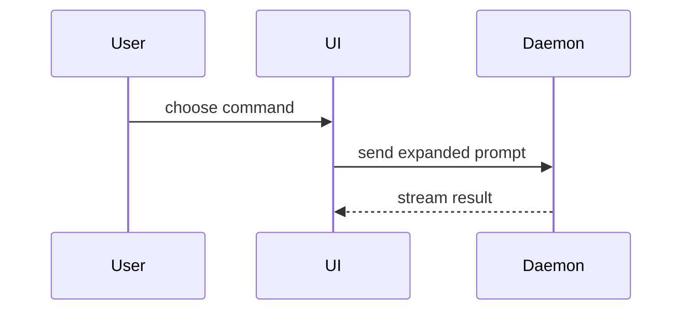

Use the template for a PR body:

```markdown
## Summary

<diagram, diff-sketch, tree, or image>

## Evidence

## Design Choices
```

## Sections

Skip preambles and use concise prose.

### Summary

Pick the smallest view that makes the key point clear.

- Show logic or an algorithm as pseudocode:

```text
on(save)
  if content is unchanged
    return cached result
  write new content
  return fresh result
```

- Show runtime control flow as a call tree:

```text
submitForm
  createSession
    persistPrompt
    launchAgent
  navigateToSession
```

- Show UI structure as a component tree, including state and module boundaries
  that matter:

```text
<SessionPage> (apps/example/src/routes/session.tsx)
  useSessionEvents()
  <SessionToolbar>
    <RunSkillButton> (packages/ui)
```

- Show file responsibility or a broad refactor as a shallow file tree:

```text
src/
├── commands/       # parses user actions
├── sessions/       # owns session state
└── transport/      # sends API requests
```

- Show component interaction, control flow, or data flow with Mermaid:



- Use `diff` when the point is what changes and the surrounding shape already
  exists. Match the diff shape to the topic.

For a component change:

```diff
 <SessionPage>
   useSessionEvents()
   <SessionToolbar>
+    <RunSkillButton />
   <SessionTimeline>
+    <SkillResultCard />
```

For a file-layout change:

```diff
 src/
 ├── commands/
+│   └── show-me.ts       # expands the slash command
 ├── sessions/
-└── transport.ts
+└── transport/
+    ├── client.ts
+    └── stream.ts
```

For a call-tree or call-stack change:

```diff
 submitForm
   createSession
     persistPrompt
+    expandSkillMention
     launchAgent
-  navigateToSession
+  navigateToSession
+    subscribeToEvents
```

For a state or control-flow change:

```diff
 on(save)
-  write content
+  if content is unchanged
+    return cached result
+  write new content
+  invalidate cache
```

- Show the whole block when most of it is new, when omitted context would hide
  ownership or order, or when the user needs a copyable target shape:

```ts
function expandSkill(command: string): string {
  const skillName = command.slice(1);
  return `use the ${skillName} skill`;
}
```

### Evidence

Don't spam. The fact that all tests pass is expected. The approach taken to
write the code is internal. Do not cite internal documentation or notes. Those
aren't necessary to a reviewer and not only do they likely not have access but
they do not have time to be going over these.

Instead, we want to highlight and describe concisely the most critical pieces of
evidence about the change that would earn trust. This can be an integration test
flow via playwright, supporting screenshots, benchmark results, or the number of
surfaces eliminated during testing.

In general, this section should have no more than 12 sentences. There's usually
only about 2-3 pieces of key evidence.

### Design Choices

Again, don't spam. There's usually only about 2-3 critical decisions. But make
sure that a reviewer is provided with sufficient context to understand the
decision (that is contained within the PR text, and not simply name dropped;
internal docs don't count). Acknowledge any trade-offs that were accepted.

---

Again, this is a guide. You can deviate from it, but do so with intent. The main
purpose is to facilitate understanding within a limited amount of time. Shooting
for 100% clarity, 80% accuracy is a good rule of thumb when it comes to that.
